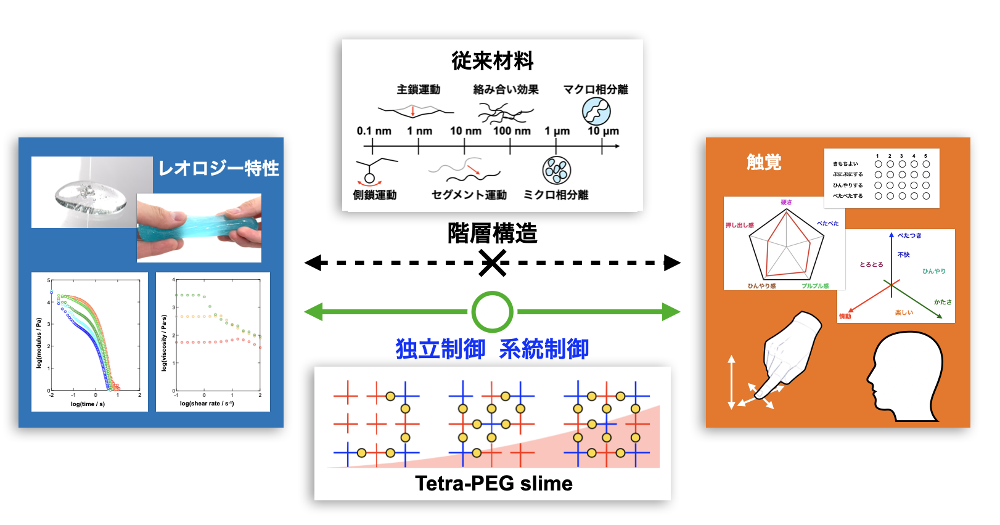

## Affiliation

Doctoral Program, Department of Bioengineering, Graduate School of Engineering, The University of Tokyo (from FY2026)

Katashima-Chung Lab.

## Research

**○ The relationship between tactile cognition and rheological property**

・Soft matter, exemplified by the human body, foods, and cosmetics, exhibits intermediate properties between viscosity and elasticity, known as **“rheological properties”**. 
→ diverse forms of tactile perception, such as “puffy” or “sticky”.

・The tactile feel of soft matter varies depending on the material properties, the contact conditions, and the manner of touching. 
→ This indicates the need to investigate how rheological properties and the context/background of participants affect touching behavior, tactile perception, and affective evaluation, which would contribute to product development and to elucidating haptic cognition.

・Soft matter possesses hierarchical structures ranging from the Å scale to the μm scale, and these structures affect rheological properties  
→ The range of materials that can be compared systematically is limited. 
→ This motivates the use of [Tetra-PEG slime](https://doi.org/10.1016/j.progpolymsci.2025.102042) as a model material whose structure can be controlled.

Keyword: Rheology · Psycho-rheology · Cognition science · Polymer physics · Gel · Transient network

## Software

### MCRDP

A graphical application for importing RheoPlus and RheoCompass measurement files and organizing selected variables into Excel workbooks.

[Source code](https://github.com/ren3100-git/MCRDP) · [Download for macOS](https://github.com/ren3100-git/MCRDP/releases/latest)

### RheoSuperposition

An application for superposing dynamic viscoelastic, stress relaxation, and creep data at a specified reference condition and exporting shift factors and shifted data.

[Source code](https://github.com/ren3100-git/RheoSuperposition) · [Download for macOS](https://github.com/ren3100-git/RheoSuperposition/releases/latest)

### Development, distribution, and disclaimer

This software is developed and distributed by an individual developer who is not enrolled in the Apple Developer Program. It is provided as is, without warranties regarding its operation, accuracy, or fitness for a particular purpose. Use of the software is at the user’s own risk. To the extent permitted by applicable law, the developer accepts no liability for damages, data loss, or other adverse consequences arising from the use of, or inability to use, the software.

## Contact

E-mail (Personal): rensato.ut[at]gmail.com
E-mail (University): sato-ren3100[at]g.ecc.u-toyko.ac.jp

## Links
- [Google Scholar](https://scholar.google.co.jp/citations?user=0wo5w1IAAAAJ&hl=ja&oi=ao)
- [Lab. information](https://rheo.tokyo/)